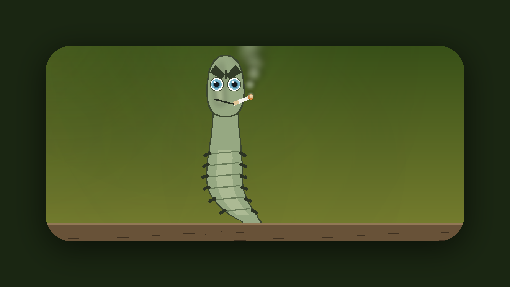
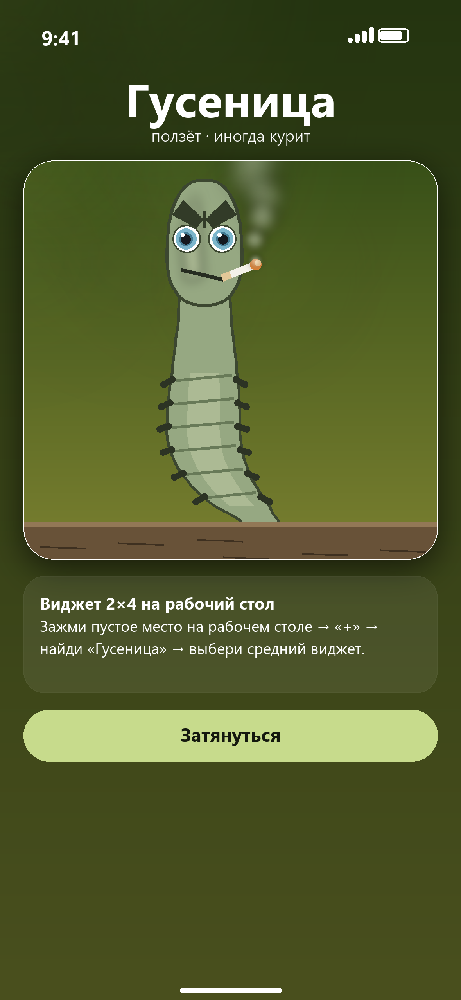
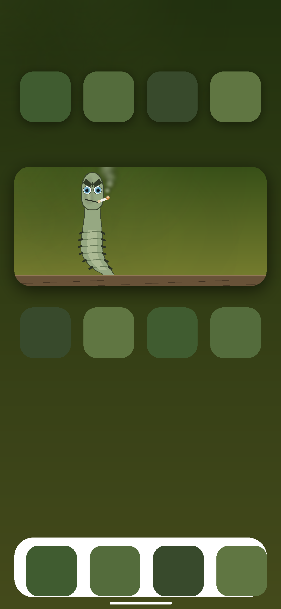

# Гусеница — iOS-приложение + виджет 2×4

Виджет-«сосед» на рабочий стол: зелёная гусеница ползёт по ветке и периодически
курит. Плюс приложение, где то же самое происходит плавно и в 60 fps.

<p align="center">
  
</p>

<p align="center">
  
  
</p>

> Мокапы отрисованы тем же кодом, что и сама сцена (питоновский рендер в
> `tools/`, повторяющий геометрию Swift-версии) — то есть показывают, как это
> будет выглядеть, а не «примерно похоже».

---

## Что внутри

| Что | Как сделано |
|---|---|
| Персонаж | Нарисован кодом в SwiftUI `Canvas` (векторно) — чётко на любом экране, никаких растровых ассетов |
| Ползание | Волна по «позвоночнику»: сегменты тела ходят синусоидой, лапки поднимаются в такт, хвост загибается и лежит на ветке |
| Курение | Цикл: 5 секунд без дыма → затяжка → дым поднимается 9 кругами с радиальными градиентами |
| Моргание, повороты головы, наклон | Отдельные фазы, всё детерминировано от времени |
| Виджет | `systemMedium` (это и есть 2×4), `TimelineProvider` отдаёт 36 кадров на 3 часа вперёд |
| Приложение | `TimelineView(.animation)` → 40 fps, тап по гусенице = затяжка |

### Честно про анимацию в виджете

WidgetKit **не поддерживает непрерывную анимацию**: виджет — это статичный
снимок, который система перерисовывает по расписанию (на практике не чаще
раза в ~5 минут). Поэтому:

* в **виджете** гусеница переползает на новое место, разворачивается и
  начинает/перестаёт курить **на каждом обновлении** (раз в 5 минут);
* в **приложении** — полноценная плавная анимация.

Если нужна именно живая анимация на рабочем столе, технически это возможно
только через костыли (Live Activity, `UIAutomatic`-хаки, jailbreak-твики) —
здесь сознательно не используется, чтобы приложение ставилось обычным
сайдлоадом.

---

## Как получить `.ipa`

> **Нет Mac?** Это не проблема — идите в **[BUILD-IPA.md](BUILD-IPA.md)**: там
> пошаговая инструкция «с нуля до приложения на iPhone» только на Windows
> (GitHub собирает `.ipa`, Sideloadly подписывает и ставит).

Собрать `.ipa` можно **только на macOS с Xcode** (нужен iOS SDK). На Windows
скомпилировать нельзя — поэтому в проекте два готовых пути.

### Путь A. GitHub Actions (Mac не нужен)

1. Залейте этот репозиторий на GitHub (приватный тоже подойдёт).
2. Откройте **Actions → Build unsigned IPA → Run workflow**.
3. Через ~3–5 минут скачайте артефакт `Caterpillar-unsigned-ipa` — внутри
   `Caterpillar.ipa`.
4. Подпишите его своим Apple ID (см. ниже) и установите.

Раннер `macos-15` уже содержит нужный Xcode; сборка идёт без подписи
(`CODE_SIGNING_ALLOWED=NO`), поэтому никакие сертификаты в CI не нужны.

### Путь B. Свой Mac

```bash
cd ipa                       # корень репозитория
bash scripts/build-ipa.sh    # соберёт Caterpillar/build/Caterpillar.ipa
```

Либо просто откройте `Caterpillar/Caterpillar.xcodeproj` в Xcode, выберите
свою команду в *Signing & Capabilities* (бесплатный Apple ID подойдёт) и
нажмите ▶︎ — приложение сразу встанет на подключённый iPhone.

Скрипт `scripts/build-ipa.sh` собирает arm64-бинарь без подписи и пакует
`Payload/Caterpillar.app` в zip с расширением `.ipa`.

### Путь C. XcodeGen (если правите структуру)

`Caterpillar/project.yml` — тот же проект в виде спеки. Если `project.pbxproj`
сломается при ручном редактировании:

```bash
brew install xcodegen
cd Caterpillar && xcodegen generate
```

---

## Как установить `.ipa` на iPhone

| Инструмент | Платформа | Срок жизни |
|---|---|---|
| **Sideloadly** (проще всего) | Windows / macOS | 7 дней на бесплатном Apple ID |
| **AltStore / SideStore** | Windows+iPhone / iPhone | 7 дней, обновляется автоматически |
| **TrollStore** | iPhone (iOS 14–17.0, зависит от версии) | бессрочно, подпись не нужна |

**Sideloadly, по шагам:**

1. Скачайте Sideloadly, подключите iPhone кабелем.
2. Перетащите `Caterpillar.ipa` в окно, введите Apple ID (создастся
   бесплатный сертификат).
3. Нажмите Start → на iPhone: *Настройки → Основные → VPN и управление
   устройством* → доверьте профилю разработчика.
4. Чтобы виджет появился в галерее: запустите приложение хотя бы раз,
   затем *долгое нажатие на рабочем столе → «+» → «Гусеница» → средний виджет*.

Если после установки виджет в галерее не появляется — почти всегда причина в
бесплатном Apple ID (у него лимиты на расширения). Тогда либо подождите
следующей пересборки/переустановки, либо подпишите платным аккаунтом
разработчика.

---

## Настройки, которые чаще всего хочется поменять

| Что | Где |
|---|---|
| Имя приложения и виджета | `App/Info.plist`, `Widget/Info.plist` → `CFBundleDisplayName` |
| Bundle ID | `tools/gen_xcodeproj.py` (`BUNDLE_APP`, `BUNDLE_WIDGET`) → затем перегенерировать проект |
| Скорость ползания | `CaterpillarPose.live` → делитель `9.0` (секунды на один цикл) |
| Частота курения | `CaterpillarPose.live` → `cyc > 5.0` и `15.0` (окно дыма в 15-секундном цикле) |
| Как часто виджет меняет кадр | `CaterpillarWidget.getTimeline` → `step = 5 * 60` |
| Цвета | `CatColor` в `Shared/CaterpillarArt.swift` |
| Размер виджета | `supportedFamilies` в `Widget/CaterpillarWidget.swift` (можно добавить `.systemLarge`) |

После правки `tools/gen_xcodeproj.py` нужно перегенерировать проект:

```bash
python tools/gen_xcodeproj.py
```

---

## Структура

```
Caterpillar/
  Caterpillar.xcodeproj/        # сгенерированный проект (+ shared scheme)
  project.yml                   # то же самое для XcodeGen
  App/
    CaterpillarApp.swift        # точка входа
    ContentView.swift           # экран с живой гусеницей и памяткой
    Info.plist
    Assets.xcassets/AppIcon…    # иконка 1024×1024 (сгенерирована)
  Shared/
    CaterpillarArt.swift        # вся графика: сцена, ветка, дым, фон
    CaterpillarPose.swift       # позы: live(at:) для app, slow(at:) для виджета
  Widget/
    CaterpillarWidget.swift     # WidgetBundle + TimelineProvider
    Info.plist
scripts/build-ipa.sh            # сборка неподписанного .ipa
.github/workflows/build-ipa.yml # сборка .ipa в CI
docs/github-workflow.yml        # копия workflow (на случай ручного создания)
BUILD-IPA.md                    # пошагово для тех, у кого нет Mac
tools/                          # Windows-инструменты разработки
  preview.py                    # рендер кадров/мокапов геометрией проекта
  mockups.py                    # мокапы экрана и рабочего стола
  make_icon.py                  # иконка приложения
  gen_xcodeproj.py              # генератор project.pbxproj + scheme
  validate.py                   # проверки без Xcode
```

## Проверки без Xcode

То, что можно проверить на Windows:

```bash
python tools/validate.py
```

Скрипт парсит `project.pbxproj` как OpenStep-plist, проверяет, что все ссылки
на объекты живут, что оба таргета на месте, что `CaterpillarArt.swift` и
`CaterpillarPose.swift` компилируются в оба таргета, что `Info.plist`-ы
валидны, а иконка — 1024×1024 без прозрачности.

Чего проверить нельзя: компиляцию Swift. Первая сборка — на macOS/CI; если
Xcode на что-то поругается, пришлите текст ошибки, поправлю.

## Требования

* iOS 17.0+ (нужен `.containerBackground` и новый API виджетов);
* Xcode 15+ / iOS 17 SDK;
* интернет на телефоне не нужен, приложение полностью офлайновое.
